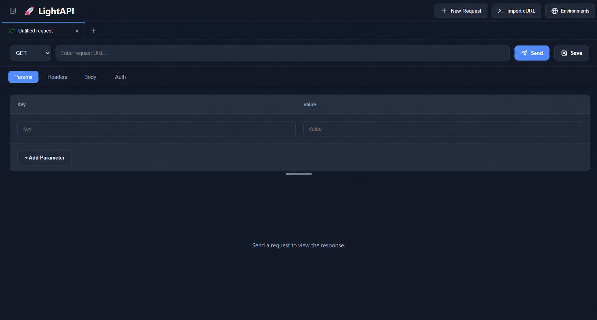

# LightAPI

A lightweight, fast and modern REST API client built with React.

## Screenshot

LightAPI request workspace with query parameters and response viewer.

## Features

- REST API Testing
- Query Parameters
- Headers
- JSON Body
- Bearer / Basic / API Key Authentication
- Request History
- Collections
- Local Storage
- Import / Export
- Environment Variables
- GraphQL (Coming Soon)
- WebSocket (Coming Soon)

## Site

[Live Demo](https://lightapi.netlify.app/)
